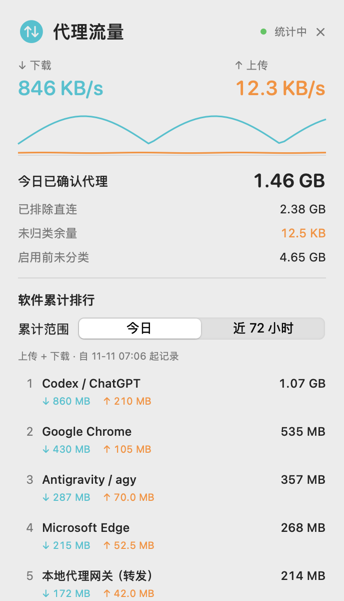

# macOS Proxy Traffic Meter

macOS 菜单栏代理流量监控工具，连接本机 Clash / Mihomo API。
无需 CLIProxyAPI、模型账号或额外 Python 包。



## 功能

- 菜单栏显示代理上传、下载速度和今日累计量，固定宽度、小字体。
- 可滚动面板；点击外部、切换应用、按 Esc 或点击 × 即可关闭。
- 按软件汇总累计流量，切换今日／最近 72 小时，查看上传和下载明细。
- 每 10 秒保存上传＋下载最高的 Top 20 目标，滚动保留 72 小时。
- 区分确认代理、确认直连、拒绝及未归类流量。
- 每新增 10 GB 弹窗一次；上一条警告未关闭时到达下一档，会切断 Clash 代理。

**自动切断的具体行为：** 设置 GLOBAL 为 REJECT、切换 global 模式并关闭
现有连接。不会退出 Clash，也不会允许客户端直接绕过代理。关闭警告或跨天都
不会自动解除切断，需要执行下方的 resume 命令。告警预算包含确认代理与未归类
余量，排除确认直连；1 GB = 1,000,000,000 bytes。

## 环境

- macOS 13 或更新版本。
- Python 3.10+，仅使用标准库。
- Xcode Command Line Tools：`xcode-select --install`。
- 正在运行的 Clash / Mihomo；启用本机 HTTP(S) controller 或 Unix socket，
  并准备好其 API secret。GLOBAL selector 需要包含 REJECT。

Apple Silicon 已验证；安装脚本按本机架构构建，Intel 尚未进行实机验证。

## 安装

```sh
git clone https://github.com/yjdeng1/macos-proxy-traffic-meter.git
cd macos-proxy-traffic-meter
python3 install.py --controller-url http://127.0.0.1:9090 \
  --timezone Asia/Shanghai --proxy-ports 7890,7897
```

端口请按你自己的 Clash 配置填写。安装时会提示输入 controller secret，
输入不会显示；未设置 secret 的 controller 可直接回车。
非交互安装可用 `--secret-env CLASH_API_SECRET` 从当前进程环境读取。

Unix socket 安装示例：

```sh
python3 install.py --controller-socket /path/to/mihomo.sock \
  --timezone Asia/Shanghai --proxy-ports 7890,7897
```

安装到当前用户，不需要 sudo。Swift 缓存和构建产物位于临时目录，构建后清理。

| 内容 | 默认位置 |
| --- | --- |
| 菜单栏应用 | `~/Applications/Proxy Traffic.app` |
| 私有配置、脚本和数据 | `~/Library/Application Support/ProxyTrafficMeter/` |
| 后台服务 | `~/Library/LaunchAgents/dev.proxytraffic.meter.*.plist` |

默认时区为 UTC，建议安装时显式指定。每日统计在该时区的 00:00 重置，
历史记录仍滚动保留 72 小时。重复安装保留已有配置、统计和切断状态。
如目标位置存在其他应用，安装器会拒绝覆盖。

## 使用与查询

点击菜单栏图标打开面板。软件排行按上传＋下载总量排序，同一软件的辅助进程
会合并；悬停可查看底层进程和部分目标域名。面板打开时每 10 秒更新排行。
右键菜单可单独退出界面，后台统计和告警继续工作。

```sh
METER_HOME="$HOME/Library/Application Support/ProxyTrafficMeter"

# 今日软件排行
python3 "$METER_HOME/traffic_history.py" --today --group software --sort total

# 最近 72 小时，按下载量排序
python3 "$METER_HOME/traffic_history.py" --hours 72 --sort download

# 指定时间段；日期时间不带时区时使用配置中的时区
python3 "$METER_HOME/traffic_history.py" \
  --since 2026-01-01T12:00 --until 2026-01-01T13:00 --json

# 当前状态、手动恢复代理
python3 "$METER_HOME/traffic_guard.py" status
python3 "$METER_HOME/traffic_guard.py" resume
```

## 统计边界与隐私

- 统计来自 Mihomo 的活跃连接快照，不是机场账单，也不含机场计费倍率。
- 快照间结束的短连接和末尾流量可能无法识别，单列为未归类余量。
- 历史从启用时开始；软件累计仅包含其进入每个窗口 Top 20 时保存的记录，
  其余目标保存合计，不会假装还原全天全部软件用量。
- 进程识别优先使用 controller 信息，再尝试本机 socket 对应的进程。
  无法识别时显示“未识别进程”；本地转发进程不等于原始客户端。
- 历史保留域名、软件、流量和可识别 PID；不保存请求正文、URL 路径、查询参数
  或认证头。数据库和配置权限为 0600，运行目录为 0700。
- 配置、凭据、数据库、日志及构建产物被 Git 忽略。截图仅含合成示例数据。
- 记录过期后，后台运行时每分钟清理；查询始终排除超过 72 小时的记录。

## 卸载

```sh
python3 install.py --uninstall
# 同时删除该工具的配置和历史：
python3 install.py --uninstall --purge
```

自定义安装路径时，卸载也传入相同的 `--runtime`、`--apps-dir` 和
`--agents-dir`。默认卸载保留配置及历史；不会修改 Clash 配置或其他进程。

## 开发与验证

```sh
python3 -m unittest discover -p '*_test.py'
swiftc -O -framework AppKit -framework SwiftUI proxy_traffic_menu.swift -o /tmp/ProxyTraffic
```

安装的 Mihomo 存在时，集成测试会启动 PID 文件标记的独立实例，
仅访问 loopback 测试服务；不会重载生产 Clash，也不下载外网测试数据。
可用 `MIHOMO_BINARY=/path/to/mihomo` 指定测试二进制。

`install.py --no-start` 可生成应用和 LaunchAgent 文件而不启动服务。
原生预览可用 `--render-preview /tmp/panel.png`；附加
`--self-test-interactions` 可验证本应用内部的关闭、滚动事件。

License: [MIT](LICENSE).
